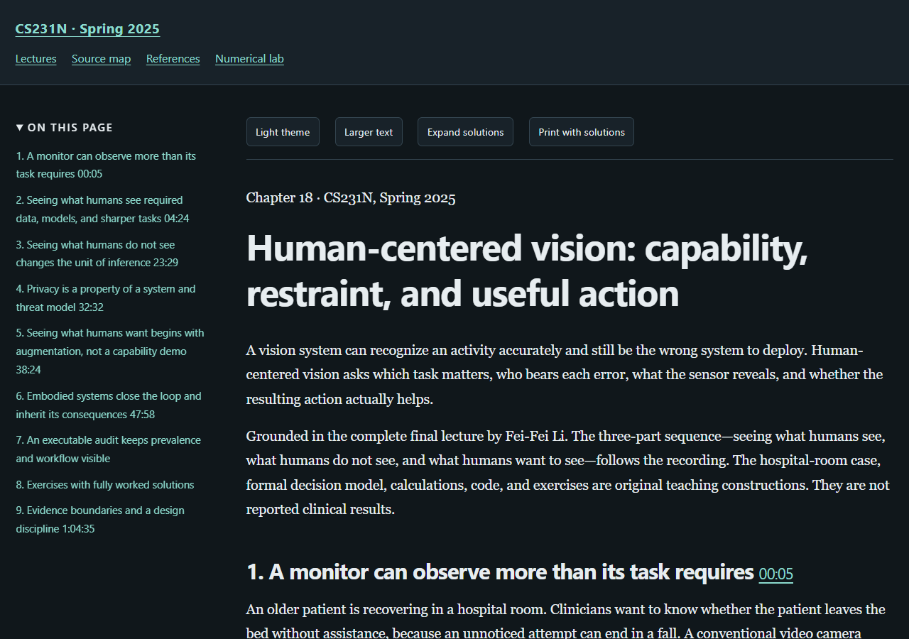

# Stanford CS231N — Deep Learning for Computer Vision, Spring 2025

An independent, transcript-grounded study edition based on Stanford Online recordings. The course and recordings are Stanford's work; the expanded exposition, derivations, examples, exercises, and validation materials in this repository are an independent educational contribution.

[Read the live textbook](https://az9713.github.io/cs231n-deep-learning-for-computer-vision-notes/) · [Source and timestamp map](https://az9713.github.io/cs231n-deep-learning-for-computer-vision-notes/source-map.html) · [Primary references](https://az9713.github.io/cs231n-deep-learning-for-computer-vision-notes/references.html)
[Official course page](https://cs231n.stanford.edu/) · [Source YouTube playlist](https://www.youtube.com/playlist?list=PLoROMvodv4rOmsNzYBMe0gJY2XS8AQg16)

The edition contains 18 chapters, approximately 68,000 prose words, 108 exercises with worked solutions, and 18 executable examples. It covers visual recognition, image classification, optimization, neural architectures, attention, generative models, 3D vision, video, robotics, and embodied intelligence. Each major source-grounded section links to the relevant moment in its recording.

## Read the lectures online

| Lecture | Live chapter | Stanford source video |
|---:|---|---|
| 1 | [From pixels to visual intelligence](https://az9713.github.io/cs231n-deep-learning-for-computer-vision-notes/lecture-01-visual-intelligence.html) | [YouTube recording](https://www.youtube.com/watch?v=2fq9wYslV0A) |
| 2 | [From remembered examples to learned class scores](https://az9713.github.io/cs231n-deep-learning-for-computer-vision-notes/lecture-02-classification-and-linear-models.html) | [YouTube recording](https://www.youtube.com/watch?v=pdqofxJeBN8) |
| 3 | [Choosing a solution and finding it](https://az9713.github.io/cs231n-deep-learning-for-computer-vision-notes/lecture-03-regularization-and-optimization.html) | [YouTube recording](https://www.youtube.com/watch?v=dyNGd06MWn4) |
| 4 | [Neural representations and the backward computation](https://az9713.github.io/cs231n-deep-learning-for-computer-vision-notes/lecture-04-networks-and-backpropagation.html) | [YouTube recording](https://www.youtube.com/watch?v=25zD5qJHYsk) |
| 5 | [Convolution, spatial structure, and the cost of downsampling](https://az9713.github.io/cs231n-deep-learning-for-computer-vision-notes/lecture-05-convolution-and-spatial-structure.html) | [YouTube recording](https://www.youtube.com/watch?v=f3g1zGdxptI) |
| 6 | [Making a convolutional model trainable](https://az9713.github.io/cs231n-deep-learning-for-computer-vision-notes/lecture-06-training-and-residual-networks.html) | [YouTube recording](https://www.youtube.com/watch?v=aVJy4O5TOk8) |
| 7 | [Recurrent state, sequence learning, and credit across time](https://az9713.github.io/cs231n-deep-learning-for-computer-vision-notes/lecture-07-recurrent-state-and-sequences.html) | [YouTube recording](https://www.youtube.com/watch?v=kG2lAPBF7zA) |
| 8 | [Attention, transformers, and the geometry of information exchange](https://az9713.github.io/cs231n-deep-learning-for-computer-vision-notes/lecture-08-attention-and-transformers.html) | [YouTube recording](https://www.youtube.com/watch?v=RQowiOF_FvQ) |
| 9 | [Dense prediction, object sets, and visual explanations](https://az9713.github.io/cs231n-deep-learning-for-computer-vision-notes/lecture-09-detection-segmentation-and-explanation.html) | [YouTube recording](https://www.youtube.com/watch?v=PTypu6GqEd4) |
| 10 | [Video understanding: motion, memory, and selective observation](https://az9713.github.io/cs231n-deep-learning-for-computer-vision-notes/lecture-10-video-motion-and-memory.html) | [YouTube recording](https://www.youtube.com/watch?v=wElqklprhPE) |
| 11 | [Distributed training: make the whole machine useful](https://az9713.github.io/cs231n-deep-learning-for-computer-vision-notes/lecture-11-distributed-training.html) | [YouTube recording](https://www.youtube.com/watch?v=9MvD-XsowsE) |
| 12 | [Self-supervision: choose what a representation must preserve](https://az9713.github.io/cs231n-deep-learning-for-computer-vision-notes/lecture-12-self-supervised-representations.html) | [YouTube recording](https://www.youtube.com/watch?v=4howBU7THbM) |
| 13 | [From recognizing a part to modeling possible parts](https://az9713.github.io/cs231n-deep-learning-for-computer-vision-notes/lecture-13-generative-models-and-variational-inference.html) | [YouTube recording](https://www.youtube.com/watch?v=zbHXQRUNlH0) |
| 14 | [Learn a distribution by competition—or by transporting noise](https://az9713.github.io/cs231n-deep-learning-for-computer-vision-notes/lecture-14-adversarial-generation-and-diffusion.html) | [YouTube recording](https://www.youtube.com/watch?v=Edr4uZFh4EE) |
| 15 | [Choose a representation for the geometric question you need to answer](https://az9713.github.io/cs231n-deep-learning-for-computer-vision-notes/lecture-15-geometry-and-neural-scenes.html) | [YouTube recording](https://www.youtube.com/watch?v=7lxrKDKtykM) |
| 16 | [Vision-language foundation models: alignment, grounding, and composition](https://az9713.github.io/cs231n-deep-learning-for-computer-vision-notes/lecture-16-vision-and-language.html) | [YouTube recording](https://www.youtube.com/watch?v=mQOK0Mfyrkk) |
| 17 | [Robot learning: perception inside a feedback loop](https://az9713.github.io/cs231n-deep-learning-for-computer-vision-notes/lecture-17-robot-learning.html) | [YouTube recording](https://www.youtube.com/watch?v=XSfmOH_xVSU) |
| 18 | [Human-centered vision: capability, restraint, and useful action](https://az9713.github.io/cs231n-deep-learning-for-computer-vision-notes/lecture-18-human-centered-vision.html) | [YouTube recording](https://www.youtube.com/watch?v=g8UaBfj6Sh8) |

## What this edition adds

The recordings determine the topic sequence and timestamp anchors. This edition adds mathematical derivations, original numerical examples, implementation checks, primary-research extensions, and six worked exercises per chapter. The source map and chapter metadata distinguish lecture material, research extensions, and original teaching constructions.

A timestamp identifies the related lecture discussion. It does not imply that Stanford presented every derivation, example, correction, or research extension in that section. Research findings are attributed to their primary sources.

## Validation

All 18 embedded chapter programs and the cumulative numerical laboratory pass. Offline desktop/mobile checks cover MathJax, navigation, search, reader controls, local links, timestamps, and interactive laboratory behavior.

- [Completion record](completion.json)
- [Editorial audit](editorial-audit.json)
- [Numerical validation](numerical-validation.json)
- [Reader validation](reader-validation.json)
- [Interactive lab checks](lab-browser-checks.json)

These checks support the finite examples, presentation, and source mapping. They do not reproduce large neural-training or hardware benchmarks, formally verify every statement, or certify deployed-system safety.

## Attribution and source boundary

This is an independent educational project, not an official Stanford publication or endorsement. Course names, recordings, and cited research belong to their respective creators. Recordings are linked rather than redistributed.

The complete local machine transcripts were read sequentially and technical claims were checked against available official slides and primary references. Automatic speech recognition can contain errors, and text extraction does not constitute complete visual review of every slide or demonstration. Raw recordings, transcripts, downloaded slides, acquisition logs, and private working files are excluded from this repository.

## Use locally

Download the repository ZIP, extract it, and open `index.html`. The HTML, CSS, JavaScript, and mathematical rendering work offline. Recording and research links require internet access.

Run the numerical checks with the commands documented in the repository's validation files and existing Python helpers. The examples are compact educational implementations with stated assumptions, not production training or control systems.

GitHub Pages serves this repository from the `main` branch root. `.nojekyll` preserves the static bundle. Bundled MathJax is distributed under the license in `assets/mathjax-LICENSE`.

Prepared 26 September 2026.
